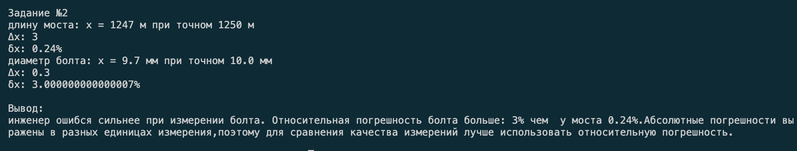
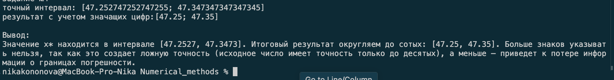
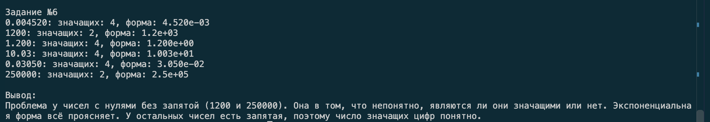
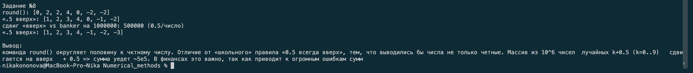
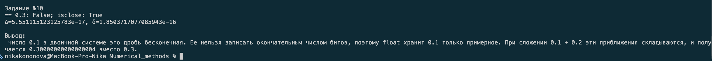
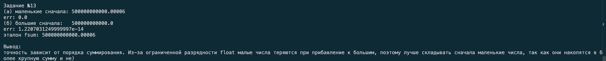
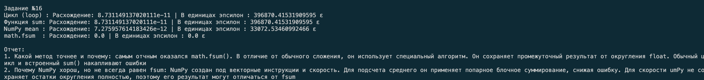

# Блок 1. Абсолютная и относительная погрешность (задачи 1–5)
### Задача 1 
```python
import math
import mpmath

print("Задание №1")

def absolute_error(approx, exact):
    return abs(approx - exact)

def relative_error_percent(approx, exact):
    if exact == 0:
        return float('inf')
    return abs(approx - exact) / abs(exact) * 100


res = []
num = [
        ("1", 3.14, math.pi),
        ("2", 2.718, math.e),
        ("3", 9.8, 9.81),
        ("4", 0.333, 1/3)
]

for number, x, x2 in num:
    abs_error = absolute_error(x, x2)
    rel_error = relative_error_percent(x, x2)

    res.append((number, abs_error, rel_error))
    print(f"{number}:")
    print(f"Δx: {abs_error}")
    print(f"δx: {rel_error}%\n")


def g_absolute_error(item):
    return item[1]

def g_relative_error(item):
    return item[2]


by_abs = sorted(res, key=g_absolute_error)
by_rel = sorted(res, key=g_relative_error)

print("Сортировка по абсолютной погрешности:")
print([r[0] for r in by_abs])
print("Сортировка по относительной погрешности:")
print([r[0] for r in by_rel])
```

**Вывод:** качество приближения от лучшего к худшему. Порядки Δx и δx НЕ совпали для пар 1 и 4. Это произошло потому, что числа разного масштаба: 0.333 меньше 3.14 почти в 10 раз, поэтому меньшая абсолютная ошибка дает большую относительную погрешность.

### Задача 2
```python
print("Задание №2")

def relative_error_percent(x, exact):
    return abs(x - exact) / abs(exact) * 100

d_bridge = absolute_error(1247, 1250)
r_bridge = relative_error_percent(1247, 1250)

d_bolt = absolute_error(9.7, 10.0)
r_bolt = relative_error_percent(9.7, 10.0)
print(f"длину моста: x = 1247 м при точном 1250 м\nΔx: {d_bridge}\nδx: {r_bridge}%")
print(f"диаметр болта: x = 9.7 мм при точном 10.0 мм\nΔx: {d_bolt:.1f}\nδx: {r_bolt}%")
```

**Вывод:** инженер ошибся сильнее при измерении болта. Относительная погрешность болта больше: 3% чем  у моста 0.24%.Абсолютные погрешности выражены в разных единицах измерения,поэтому для сравнения качества измерений лучше использовать относительную погрешность.

### Задача 3
```python
print("Задание №3")

def relative_error(approx, exact):
    if exact == 0:
        return float('inf')
    return abs(approx - exact) / abs(exact)


print(relative_error(3.14, math.pi))
print(relative_error(2.718, math.e))
print(relative_error(9.8, 9.81))
print(relative_error(0.333, 1/3))

print(f"\nПроверка деления на ноль: {relative_error(1, 0)}")
```


**Вывод:** функция возвращает inf при exact=0. На чет. парах ее значения совподают с относительными погрешностями, вычисленными ранее

### Задача 4
```python
print("Задание №4")
approx_value = 47.3
relative_error = 0.001
a = approx_value / (1 + relative_error)
b = approx_value / (1 - relative_error)
print(f"точный интервал: [{a}; {b}]")
print(f"результат с учетом значащих цифр:[{round(a, 2)}; {round(b, 2)}]")
```

**Вывод:** Значение x* находится в интервале [47.2527, 47.3473]. Итоговый результат округляем до сотых: [47.25, 47.35]. Больше знаков указывать нельзя, так как это создает ложную точность (исходное число имеет точность только до десятых), а меньше — приведет к потере информации о границах погрешности.

### Задача 5
```python
max_abs_error_A = 0.3
max_abs_error_B = 0.005
T = max_abs_error_A/max_abs_error_B
print(f"Решение неравенства: |T| <= {T} °C") 

for t in  [-100, -50, -10, 10, 50, 100]:
    B = abs(t) * max_abs_error_B
    if B <= max_abs_error_A:
        str_who = "B"
    else:
        str_who = "A"
    print(f"T : {t:>4} C: Δ_B = {B:.2f} C -> точнее {str_who}")
```


**Вывод:** датчик В точнее при |T| ≤ 60 С. При маленьких  |T| относительная ошибка B даёт малую абсолютную ошибку , поэтому B точнее A. При |T| > 60 С абсолютная ошибка B превышает 0.3 С , следовательно,выбор датчика зависит от диапазона измерений: A — для большого диапазона, B — для маленького. 

# Блок 2. Значащие цифры и округление (задачи 6–9)
### Задача 6
```python
num = [
    ("0.004520", 4),
    ("1200",     2),  
    ("1.200",    4),
    ("10.03",    4),
    ("0.03050",  4),
    ("250000",   2)
]
for num_str, sig in num:
    form = f"{float(num_str):.{sig-1}e}"
    print(f"{num_str}: значащих: {sig}, форма: {form}")
```

**Вывод:**Проблема у чисел с нулями без запятой (1200 и 250000). Она в том, что непонятно, являются ли они значащими или нет. Экспоненциальная форма всё проясняет. У остальных чисел есть запятая, поэтому число значащих цифр понятно.")

### Задача 7
```python

measured_value = 4.738291
absolute_error = 0.02
print(f"x: {round(measured_value, 2)} ± {absolute_error}  =>  4.74 ± 0.02")

```

**Вывод:** погрешность Δ = 0.02 относится к сотым, поэтому  последняя верная цифра результата тоже должна быть  сотой: 4.74 ± 0.02. Осталось только 3 значащих цифр. 4.738291 ± 0.02  это не правильно, так как  она заявляет точность до 1e-6, тогда как реальная точность — 0.02 (сотые). Это ложная точность, то есть вводящая в заблуждение информация о качестве измерения

### Задача 8
```python
val =[0.5,1.5,2.5,3.5,-0.5,-1.5,-2.5]
print(f"round(): {[round(x) for x in val]}")
print("«.5 вверх»:", [math.floor(v + 0.5) for v in val])

n = 1_000_000

sdvig = 0
for i in range(n):
    k = i % 10
    v = k + 0.5
    up = math.floor(v + 0.5)   
    bank = round(v)                
    sdvig += up - bank

print(f"сдвиг «вверх» vs banker на {n}: {sdvig} ({sdvig/n}/число)")

print("«.5 вверх»:", [int(v + 0.5) if v > 0 else int(v - 0.5) for v in val])

```

**Вывод:** команда round() округляет половину к чктному числу. Отличие от «школьного» правила «0.5 всегда вверх», тем, что выводились бы числа не только четные. Массив из 10^6 чисел  лучайных k+0.5 (k=0..9)   сдвигается на вверх   + 0.5 => сумма уедет ~5e5. В финансах это важно, так как приводит к огромным ошибкам сумм

### Задача 9
```python
def absolute_error(approx, exact):
    return abs(approx - exact)


def rel_err(a, e):
    if e == 0:
        if a != 0:
            return float('inf')
        return 0.0
    return abs(a - e) / abs(e)

num = [1.0/k for k in range(1, 101)]
s_float = sum(num)
s_round = sum(round(x, 3) for x in num)
s_ref = math.fsum(num)
print(f"S_float: {s_float}\nΔ: {absolute_error(s_float, s_ref)}\n err: {rel_err(s_float, s_ref)}")
print(f"S_round: {s_round}\nΔ: {absolute_error(s_round, s_ref)}\n err: {rel_err(s_round, s_ref)}")
print(f"S_ref: {s_ref}")

error_a = absolute_error(s_float, s_ref)
error_b = absolute_error(s_round, s_ref)

if error_a == 0:
    print("\nошибка (б) больше ошибки (а) в бесконечно много раз (ошибка 'а' равна 0)")
else:
    ratio = error_b / error_a
    
    print(f"\nошибка (б) больше ошибки (а) в {ratio:.2f} раз") 
```

**Вывод:** без промежуточных округлений вариант (а). Ошибка будет маленькой - порядка машинной точности. Если округлить каждое слагаемое до трех знаков варант (б), Ошибка становится больше. Правило: округлять нужно только итоговый результат, а промежуточные вычисления делать с максимальной точностью

### Задача 10
```python
def absolute_error(approx, exact):
    return abs(approx - exact)
summ = 0.1+0.2
print(f"== 0.3: {summ == 0.3}; isclose: {math.isclose(summ, 0.3)}")
print(f"Δ={absolute_error(summ,0.3)}, δ={rel_err(summ,0.3)}")

```

**Вывод:** число 0.1 в двоичной системе это дробь бесконечная. Ее нельзя записать окончательным числом битов, поэтому float хранит 0.1 только примерное. При сложении 0.1 + 0.2 эти приближения складываются, и получается 0.30000000000000004 вместо 0.3.

### Задача 11
```python
mpmath.mp.dps = 50

def rel_err(a, e):
    if e == 0:
        if a != 0:
            return float('inf')
        return 0.0
    return abs(a - e) / abs(e)
a = 1 +1e-15
b = 1.0
print(f"a-b: {a-b}\nδ={rel_err(a-b,1e-15)}")
a_2 = 1.0
b_2 = 1e8
c = 1.0
disc = math.sqrt(b_2*b_2 - 4*a_2*c)
bad  = (-b_2 + disc) / (2*a_2)
good = (2*c) / (-b_2 - disc)
ma = mpmath.mpf(1.0)
mb = mpmath.mpf(10**8)
mc = mpmath.mpf(1.0)
exact = (-mb + mpmath.sqrt(mb**2 - 4*ma*mc)) / (2*ma)
print(f"error плохо: {float(rel_err(mpmath.mpf(str(bad)), exact))}")
print(f"err хорошо:  {float(rel_err(mpmath.mpf(str(good)), exact))}")

```

**Вывод:** при вычитании близких чисел в стандартном float теряется часть значащих цифр, возникает большая погрешность. Благодаря новой формуле этого можно избежать. Точность хорошего метода оказывается почти отличной по сравнению с плохим

### Задача 12
```python
arr = [0.1]*1_000_000
ref = 1e5


def absolute_error(approx, exact):
    return abs(approx - exact)

def relative_error_percent(approx, exact):
    if exact == 0:
        return float('inf')
    return abs(approx - exact) / abs(exact) * 100

t_1 = 0.0
for x in arr:
    t_1 += x
t_2 = sum(arr)
t_3 = math.fsum(arr)

print(f"{'метод'} | {'результат'} | {'Δ'} | {'δ'}")
for name, val in [("naive", t_1), ("sum", t_2), ("fsum", t_3)]:
    print(f"{name} | {val} | {absolute_error(val, ref)} | {relative_error_percent(val, ref)}")
```

**Вывод:** наиболее точен math.fsum:его погрешность нулевая.Наивный цикл и sum показывают одинаковую ошибку из-за накопления округлений промежуточных сумм во float. По сравнению с ними math.fsum точнее в много раз

### Задача 13
```python
def absolute_error(approx, exact):
    return abs(approx - exact)

def relative_error_percent(approx, exact):
    if exact == 0:
        return float('inf')
    return abs(approx - exact) / abs(exact) * 100


small = [1e-10] * 500_000
big = [1e6] * 500_000
mix = small + big   
s_small_first =0.0
for i in mix:
    s_small_first += i

s_big_first =0.0
for i in reversed(mix):
    s_big_first += i 
s_ref = math.fsum(mix)
print(f"(а) маленькие сначала: {s_small_first!r}\nerr: {relative_error_percent(s_small_first, s_ref)}\n(б) большие сначала:   {s_big_first!r}\nerr: {relative_error_percent(s_big_first, s_ref)}\nэталон fsum: {s_ref!r}")
```

**Вывод:** точность зависит от порядка суммирования. Из-за ограниченной разрядности float малые числа теряются при прибавление к большим, поэтому лучше складывать сначала маленькие числа, так как они накопятся в более крупную сумму и не

### Задача 14
```python
def relative_error_percent(approx, exact):
    if exact == 0:
        return float('inf')
    return abs(approx - exact) / abs(exact) 
x =1.0
threshold_values = {1e-9: None, 1e-6: None, 1e-3: None}

for i in range(1, 10001):
    x *= 1.0001
    exact = math.exp(i * math.log(1.0001))

    a = relative_error_percent(x, exact)
    for thr in threshold_values:
        if threshold_values[thr] is None and a >thr:
            threshold_values[thr] = i
for thr_key, step in threshold_values.items():
          print(f"  {thr_key}: {step if step is not None else 'не достигнут за 10000 шагов'}")

final_exact = math.exp(10000 * math.log(1.0001))
print(f"\nx после 10000 шагов: {x}")
print(f"эталон: {final_exact}")
print(f"δ на шаге 10000: {relative_error_percent(x, final_exact)}")
```

**Вывод:** при частом умножении x *= 1.0001 ошибка увеличивается примерно линейно с числом шагов, каждое умножение добавляет примерно 2.2e-16 к относительной погрешности. Все эти добавления складываются. За 10000 шагов накопленная δ ≈ 10^-14, поэтому пороги 10^-9, 10^-6 и 10^-3 не достигаются. Ошибка растет медленно

### Задача 15
```python
from decimal import Decimal, getcontext

getcontext().prec = 28
n =1_000_000

def absolute_error(approx, exact):
    return abs(approx - exact)

def relative_error_percent(approx, exact):
    if exact == 0:
        return float('inf')
    return abs(approx - exact) / abs(exact) * 100

a_float = 0.0
for _ in range(n):
    a_float += 0.01

a_dec = Decimal("0")
for _ in range(n):
    a_dec += Decimal("0.01")

a_kop = 0
for i in range(n):
    a_kop += 1
print(f"float:   {a_float}")
print(f"Decimal: {a_dec}")
print(f"копейки: {a_kop} коп: {a_kop/100} руб\n")
print(f"float vs Decimal: Δ={absolute_error(a_float, float(a_dec)):.3e} руб  "
      f"δ={relative_error_percent(a_float, float(a_dec)):.2e}")
print(f"float vs копейки: Δ={absolute_error(a_float, a_kop/100):.3e} руб  "
      f"δ={relative_error_percent(a_float, a_kop/100):.2e}")
```

**Вывод:** float даёт 10000.0000000135 вместо 10000.00 - 0.01 не представимо в двоичной системе точно. Ошибка накапливается за много сложений. Decimal и копейки дают ровно 10000.00. В финансах float не применяют — деньги нужно считать с точностью до копейки

### Задача 16
```python

import numpy as np
import random

print("\n\nЗадание №16")
random.seed(0)
arr = [random.random() for i in range(100_000)]
s_loop = 0.0
for i in arr: 
    s_loop += i
s_sum = sum(arr)
s_fsum = math.fsum(arr)
s_np = np.mean(np.array(arr)) * len(arr)
ref = s_fsum
eps = 2.2e-16
for name, m in [("Цикл (loop) ", s_loop), 
                ("Функция sum", s_sum), 
                ("NumPy mean ", s_np), 
                ("math.fsum  ", s_fsum)]:
    
    abs_diff = abs(m - ref)
    diff_in_eps = abs_diff / eps
    print(f"{name}: Расхождение: {abs_diff} | В единицах эпсилон : {diff_in_eps} ε")

```

**Вывод:** 
1. Какой метод точнее и почему: самым отчным оказался math.fsum(). В отличие от обычного сложения, он использует специальный алгоритм. Он сохраняет промежуточный результат от округления float. Обычный цикл и встроенный sum() накапливают ошибки.
Почему NumPy хорош, но не всегда равен fsum: NumPy создан под векторные инструкции и скорость. Для подсчета среднего он применяет попарное блочное суммирование, снижая ошибку. Для скорости umPy не сохраняет остатки округления полностью, поэтому его результат могут отличаться от fsum 