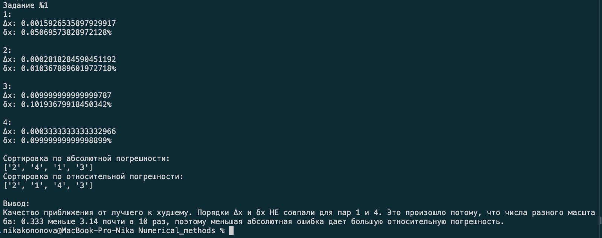
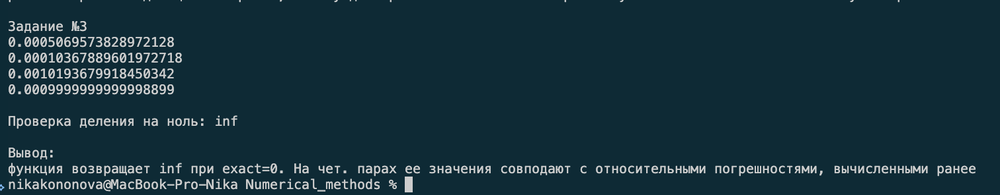
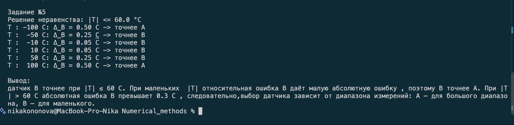
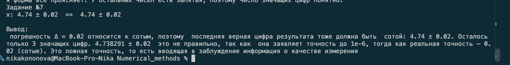
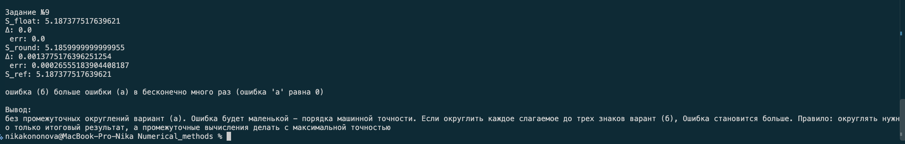
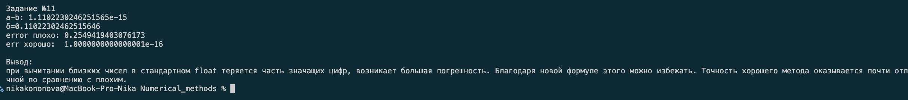
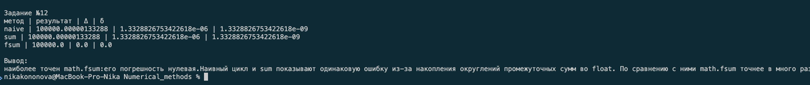
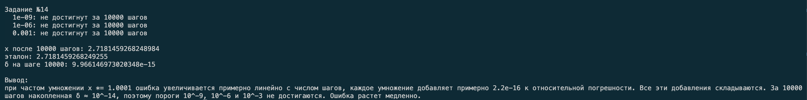
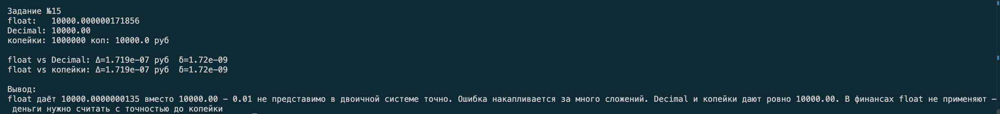

# Блок 1. Абсолютная и относительная погрешность (задачи 1–5)
### Задача 1 

**Вывод:** качество приближения от лучшего к худшему. Порядки Δx и δx НЕ совпали для пар 1 и 4. Это произошло потому, что числа разного масштаба: 0.333 меньше 3.14 почти в 10 раз, поэтому меньшая абсолютная ошибка дает большую относительную погрешность.

### Задача 2

**Вывод:** инженер ошибся сильнее при измерении болта. Относительная погрешность болта больше: 3% чем  у моста 0.24%.Абсолютные погрешности выражены в разных единицах измерения,поэтому для сравнения качества измерений лучше использовать относительную погрешность.

### Задача 3

**Вывод:** функция возвращает inf при exact=0. На чет. парах ее значения совподают с относительными погрешностями, вычисленными ранее

### Задача 4

**Вывод:** Значение x* находится в интервале [47.2527, 47.3473]. Итоговый результат округляем до сотых: [47.25, 47.35]. Больше знаков указывать нельзя, так как это создает ложную точность (исходное число имеет точность только до десятых), а меньше — приведет к потере информации о границах погрешности.

### Задача 5

**Вывод:** датчик В точнее при |T| ≤ 60 С. При маленьких  |T| относительная ошибка B даёт малую абсолютную ошибку , поэтому B точнее A. При |T| > 60 С абсолютная ошибка B превышает 0.3 С , следовательно,выбор датчика зависит от диапазона измерений: A — для большого диапазона, B — для маленького. 
# Блок 2. Значащие цифры и округление (задачи 6–9)
### Задача 6

**Вывод:**Проблема у чисел с нулями без запятой (1200 и 250000). Она в том, что непонятно, являются ли они значащими или нет. Экспоненциальная форма всё проясняет. У остальных чисел есть запятая, поэтому число значащих цифр понятно.")

### Задача 7

**Вывод:** погрешность Δ = 0.02 относится к сотым, поэтому  последняя верная цифра результата тоже должна быть  сотой: 4.74 ± 0.02. Осталось только 3 значащих цифр. 4.738291 ± 0.02  это не правильно, так как  она заявляет точность до 1e-6, тогда как реальная точность — 0.02 (сотые). Это ложная точность, то есть вводящая в заблуждение информация о качестве измерения

### Задача 8

**Вывод:** команда round() округляет половину к чктному числу. Отличие от «школьного» правила «0.5 всегда вверх», тем, что выводились бы числа не только четные. Массив из 10^6 чисел  лучайных k+0.5 (k=0..9)   сдвигается на вверх   + 0.5 => сумма уедет ~5e5. В финансах это важно, так как приводит к огромным ошибкам сумм

### Задача 9

**Вывод:** без промежуточных округлений вариант (а). Ошибка будет маленькой - порядка машинной точности. Если округлить каждое слагаемое до трех знаков варант (б), Ошибка становится больше. Правило: округлять нужно только итоговый результат, а промежуточные вычисления делать с максимальной точностью

### Задача 10

**Вывод:** число 0.1 в двоичной системе это дробь бесконечная. Ее нельзя записать окончательным числом битов, поэтому float хранит 0.1 только примерное. При сложении 0.1 + 0.2 эти приближения складываются, и получается 0.30000000000000004 вместо 0.3.

### Задача 11

**Вывод:** при вычитании близких чисел в стандартном float теряется часть значащих цифр, возникает большая погрешность. Благодаря новой формуле этого можно избежать. Точность хорошего метода оказывается почти отличной по сравнению с плохим

### Задача 12

**Вывод:** наиболее точен math.fsum:его погрешность нулевая.Наивный цикл и sum показывают одинаковую ошибку из-за накопления округлений промежуточных сумм во float. По сравнению с ними math.fsum точнее в много раз

### Задача 13

**Вывод:** точность зависит от порядка суммирования. Из-за ограниченной разрядности float малые числа теряются при прибавление к большим, поэтому лучше складывать сначала маленькие числа, так как они накопятся в более крупную сумму и не

### Задача 14

**Вывод:** при частом умножении x *= 1.0001 ошибка увеличивается примерно линейно с числом шагов, каждое умножение добавляет примерно 2.2e-16 к относительной погрешности. Все эти добавления складываются. За 10000 шагов накопленная δ ≈ 10^-14, поэтому пороги 10^-9, 10^-6 и 10^-3 не достигаются. Ошибка растет медленно

### Задача 15

**Вывод:** float даёт 10000.0000000135 вместо 10000.00 - 0.01 не представимо в двоичной системе точно. Ошибка накапливается за много сложений. Decimal и копейки дают ровно 10000.00. В финансах float не применяют — деньги нужно считать с точностью до копейки

### Задача 16

**Вывод:** 
1. Какой метод точнее и почему: самым отчным оказался math.fsum(). В отличие от обычного сложения, он использует специальный алгоритм. Он сохраняет промежуточный результат от округления float. Обычный цикл и встроенный sum() накапливают ошибки.
Почему NumPy хорош, но не всегда равен fsum: NumPy создан под векторные инструкции и скорость. Для подсчета среднего он применяет попарное блочное суммирование, снижая ошибку. Для скорости umPy не сохраняет остатки округления полностью, поэтому его результат могут отличаться от fsum 