# Блок 1. Обусловленность задачи (задачи 1–4)
### Задача 1 
```python
point_sqrt = 1e-8
point_ln = 1.001
point_sub = 1.000001
point_sin = math.pi / 2

cond_sqrt = 0.5
cond_ln = abs(1 / math.log(point_ln))
cond_sub = abs(point_sub / (point_sub - 1))
cond_sin = abs(point_sin * (math.cos(point_sin) / math.sin(point_sin)))
print(f"1. sqrt(x)  при x:{point_sqrt}: cond: {cond_sqrt:.1f}")
print(f"2. ln(x)    при x:{point_ln}: cond: {cond_ln:.1f}")
print(f"3. x - 1    при x:{point_sub}: cond: {cond_sub:.1f}")
print(f"4. sin(x)   при x: {point_sin} cond: {cond_sin:.1f}")
```
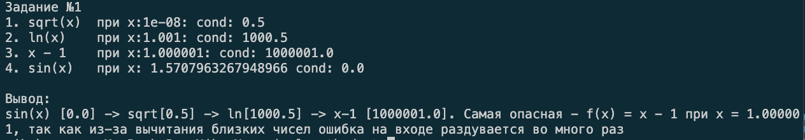
**Вывод:** sin(x) [0.0] -> sqrt[0.5] -> ln[1000.5] -> x-1 [1000001.0]. Самая опасная - f(x) = x − 1 при x = 1.000001, так как из-за вычитания близких чисел  ошибка на входе раздувается во много раз

### Задача 2
```python
a = 1 + 10**-8
b = 1
delta_a = 10**-9  
sub_a = delta_a / a 

f_base = a - b 
f_perturb = (a + delta_a) - b
delta_f = f_perturb - f_base

ratio_actual = delta_f / sub_a
cond_a = abs(a / (a - b)) 

predicted_ratio = cond_a * f_base  

print(f"Число обусловленности cond_a: {cond_a:.1f}")
print(f"Фактическое отношение Δf / δa:  {ratio_actual:.6f}")
print(f"Предсказание через cond * f:   {predicted_ratio:.6f}")
```
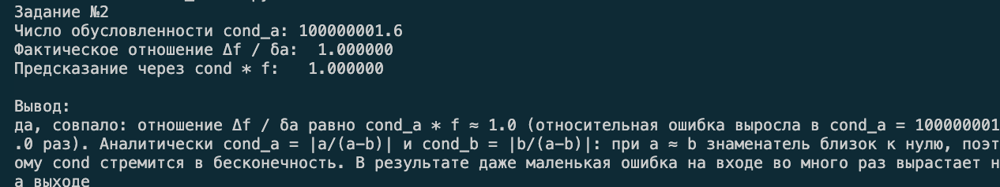
**Вывод:** да, так как результат изменился на 100000001.0, как говорил cond. При a=~b знаменатель в формуле cond близка к нулю, поэтому сам cond идет в бесконечность. В результате даже маленькая ошибка  на входе во много раз вырастает на выходе

### Задача 3
```python
print(f"{'eps'} | {'Корень'} | {'Сдвиг корня'} | {'Отношение сдвигов'}")
epsilon_list = [1e-2, 1e-4, 1e-6]

prev_shift = None 

for eps in epsilon_list:
    perturbed = 1.0 + math.sqrt(eps) 
    shift = abs(perturbed - 1.0)     

    if prev_shift is None:
        ratio_str = "-"
    else:
        ratio_str = f"{prev_shift / shift:.1f}"

    print(f"{eps} | {perturbed} | {shift} | {ratio_str}")
    prev_shift = shift 
```
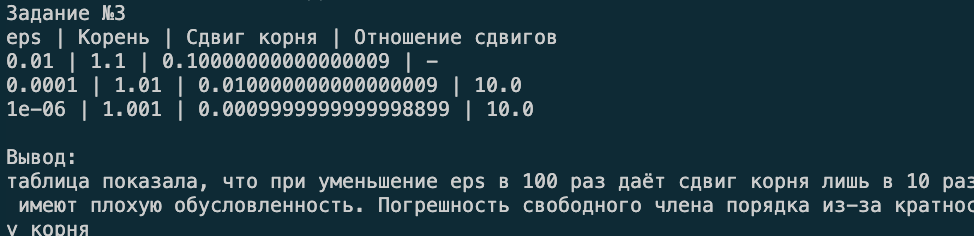
**Вывод:** таблица показала, что при уменьшение eps в 100 раз даёт сдвиг корня лишь в 10 раз. Значит, кратные корни имеют плохую обусловленность. Погрешность свободного члена порядка из-за кратности превращается в ошибку корня

### Задача 4
```python
num = (math.sqrt(5) - 1) / 2

def bad_num_power(n):
    if n == 0:
        return 1.0
    elif n == 1: 
        return num
    n2 = 1.0
    n1 = num
    for i in range(2, n + 1):
        curent = n2 - n1
        n2 = n1
        n1 = curent
    return n1

def good_num_power(x):
    return num ** x

print(f"{'Шаг':<5} | {'Устойчивый метод':<18} | {'Неустойчивый метод':<18}")

for n in [1, 5, 10, 15, 20, 25, 30, 35, 40]:
    good_res = good_num_power(n)
    bad_res = bad_num_power(n)
    print(f"{n:<5} | {good_res:<18.10f} | {bad_res:<18.10f}")
```
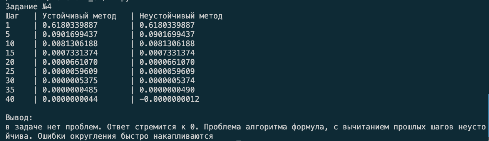
**Вывод:** в задаче нет проблем. Ответ стремится к 0. Проблема алгоритма формула, с вычитанием прошлых шагов неустойчива. Ошибки округления быстро накапливаются
# Блок 2. Устойчивость алгоритма (задачи 5–9)
### Задача 5
```python
print(f"{'b':<7} | {'Ошибка плохого':^22} | {'Ошибка хорошего':^22}")
getcontext().prec = 60
for stepen in range(4, 13, 4):
    b = 10**stepen
    a = 1.0
    c = 1.0
    discrimenant = (b**2 - 4 * a * c) ** 0.5
    x2_bad = (-b + discrimenant)/(2 * a)
    x2_good = (2 * c)/(-b - discrimenant)

    b_dec = Decimal(str(b))
    a_dec = Decimal(str(a))
    c_dec = Decimal(str(c))

    discrimenant_dec = (b_dec**2-Decimal(4) * a_dec * c_dec).sqrt()
    exact = (2 * c_dec) / (-b_dec - discrimenant_dec)
    error_bad = float(abs(Decimal(str(x2_bad)) - exact)/abs(exact))
    error_good = float(abs(Decimal(str(x2_good)) - exact)/abs(exact))
    print(f"10^{stepen:<4} | {error_bad:<22.4e} | {error_good:<22.4e}")
```
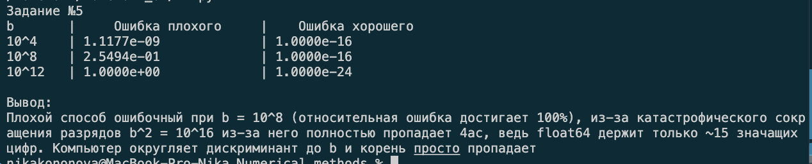
**Вывод:** Плохой способ ошибочный при b = 10^8 (относительная ошибка достигает 100%), из-за катастрофического сокращения разрядов b^2 = 10^16 из-за него полностью пропадает 4ас, ведь float64 держит только ~15 значащих цифр. Компьютер округляет дискриминант до b и корень просто пропадает 


# Блок 2. Значащие цифры и округление (задачи 6–9)
### Задача 6

```python
print(f"{'x':<7} | {'Ошибка плохого':^22} | {'Ошибка хорошего':^22}")
getcontext().prec = 50
xs_6 = []
errs_bad_6 = []
errs_good_6 = []
mpmath.mp.dps = 50
for stepen in range(2, 11, 2):
    x = 10**(-stepen)

    bad = (1.0 - math.cos(x)) / (x**2)
    good = (2.0 * (math.sin(x / 2.0)**2)) / (x**2)

    x_mp = mpmath.mpf(f"1e-{stepen}")
    exact = (1 - mpmath.cos(x_mp)) / (x_mp**2)
    error_good = float(abs(Decimal(good) - exact) / abs(exact))


    xs_6.append(x)
    errs_bad_6.append(error_bad)
    errs_good_6.append(error_good)

    str_x = f"10^-{stepen}"
    print(f"{str_x:<7} | {error_bad:<22.4e} | {error_good:<22.4e}")
```
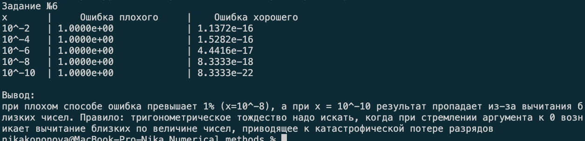
**Вывод:**при плохом способе ошибка превышает 1%(х=10^-8), а при х = 10^-10 корень  пропадает из-за вычитания близких чисел. Правило: тригонометрическое тождество надо искать , когда х стремится к 0 возникает  вычитание близких по величине чисел, приводящее к катастрофической потере разрядов


### Задача 7
```python
mpmath.mp.dps = 50

def bad(x):
    return (math.sqrt(x + 1) - math.sqrt(x))


def exact(x):
    mp_x = mpmath.mpf(str(x))
    return mpmath.sqrt(mp_x + 1) - mpmath.sqrt(mp_x)


def good(x):
    return 1 / (math.sqrt(x + 1) + math.sqrt(x))

xs = [1e4, 1e8, 1e12, 1e14, 1e16]
errs_7 = []
print(f"{'x':>7} | {'bad':>14} | {'good':>14} | {'err_bad':>10} | {'err_good':>10}")

for x in xs:
    b  = bad(x)
    g  = good(x)
    ex = exact(x)

    if ex != 0:
        error_bad = float(abs(mpmath.mpf(str(b)) - ex) / abs(ex))
    else:
        error_bad = float('inf')

    if ex != 0:
        error_good = float(abs(mpmath.mpf(str(g)) - ex) / abs(ex))
    else:
        error_good = float('inf')
    errs_7.append(error_bad)
    print(f"{x:>7.0e} | {b:>14.8e} | {g:>14.8e} | {error_bad:>10.2e} | {error_good:>10.2e}")

slope_7 = math.log10(errs_7[2] / errs_7[0]) / math.log10(xs[2] / xs[0])
print(f"Оценка показателя степени роста ошибки: p ≈ {slope_7:.2f}")
```
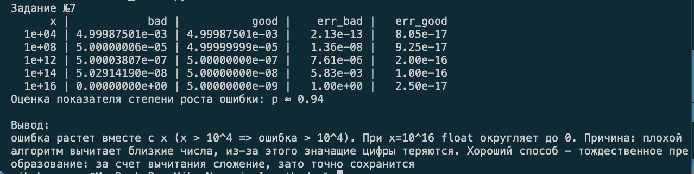
**Вывод:** пошибка растет вместе с х (x > 10^4 => ошибка > 10^4). При х=10^16 float округляет до 0. Причина: плохой алгоритм вычитает близкие числа, из-за этого значащие цифры теряются. Хороший способ — тождественное преобразование: за счет вычитания сложение, зато точно сохранится

### Задача 8
```python
def bad_8(x):
    return math.log(1 + x)

def good_8(x):
    return math.log1p(x)

def exact_8(x):
    mp_x = mpmath.mpf(str(x))
    return mpmath.log(1 + mp_x)

num = [1e-2, 1e-8, 1e-12, 1e-16]
print(f"{'x':>7} | {'bad':>14} | {'good':>14} | {'error_bad':>10} | {'error_good':>10}")

for current_x in num:
    res_bad = bad_8(current_x)
    res_good = good_8(current_x)
    res_exact = exact_8(current_x)
    
    if res_exact != 0:
        error_bad = float(abs(mpmath.mpf(str(res_bad)) - res_exact) / abs(res_exact))
    else:
        error_bad = float('inf')

    if res_exact != 0:
        error_good = float(abs(mpmath.mpf(str(res_good)) - res_exact) / abs(res_exact))
    else:
        error_good = float('inf')
    print(f"{current_x:>7.0e} | {res_bad:>14.8e} | {res_good:>14.8e} | {error_bad:>10.2e} | {error_good:>10.2e}")
```
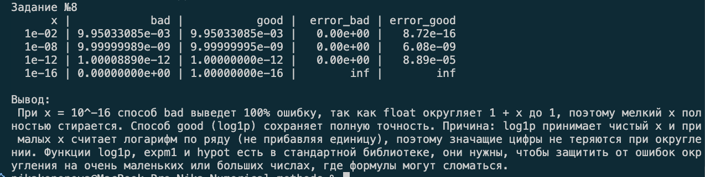
**Вывод:** При х = 10^-16 способ bad выведет ошибку, так как float округляет 1 + x до 1, поэтому мелкий х полностью стирается. Способ good (log1p) сохраняет полную точность. Причина: log1p принимает чистый х и считает логарифм по ряду (не прибавляя единицу), поэтому значащие цифры не теряются при округлении. Функции log1p, expm1 и hypot есть в стандартной библиотеке, они нужны, чтобы защитить от ошибок округления на очень маленьких или больших числах, где формулы могут сломаться.


### Задача 9
```python
def exact_sum(n):
    return mpmath.fsum([1 / mpmath.mpf(k) for k in range(1, n + 1)])

num = [10**5, 10**6, 10**7]
print(f"{'n':>10} | {'err_naive':>15} | {'err_sum':>10} | {'err_fsum':>10}")

for n in num:
    arr = [1.0/k for k in range(1, n + 1)]

    naiv = 0.0
    for val in arr:
        naiv += val
    st_sum = sum(arr)
    
    f_sum = math.fsum(arr)
    ex = exact_sum(n)
    
    if ex != 0:
        err_naive = float(abs(mpmath.mpf(str(naiv)) - ex) / abs(ex))
    else:
        err_naive = float('inf')
        
    if ex != 0:
        err_st_sum = float(abs(mpmath.mpf(str(st_sum)) - ex) / abs(ex))
    else:
        err_st_sum = float('inf')
        
    if ex != 0:
        err_fsum = float(abs(mpmath.mpf(str(f_sum)) - ex) / abs(ex))
    else:
        err_fsum = float('inf')

    print(f"{n:>10} | {err_naive:>15.2e} | {err_st_sum:>10.2e} | {err_fsum:>10.2e}")

```
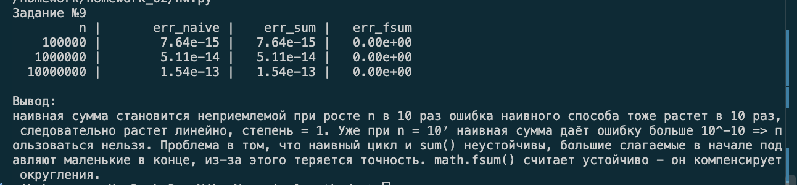
**Вывод:** наивная сумма становится неприемлемой при росте n  в 10 раз ошибка наивного способа тоже растет в 10 раз, следовательно растет линейно, степень = 1. Уже при n = 10⁷ наивная сумма даёт ошибку больше 10^-10 => пользоваться нельзя. Проблема в том, что  наивный цикл и sum() неустойчивы, большие слагаемые в начале подавляют маленькие в конце, из-за этого теряется точность. math.fsum() считает устойчиво - он компенсирует округления

# Блок 3. Корректная постановка эксперимента (задачи 10–15)

### Задача 10
```python
def float32_emulation(val):
    if val == 0:
        return 0.0
    order = math.floor(math.log10(abs(val)))
    return round(val, -order + 6)
exact_a1 = 0.4999999995833333  
exact_a2 = 0.5 

#a
x_a1 = 1e-4
x_a2 = 1e-8

bad_a1 = (1.0 - math.cos(x_a1)) / (x_a1**2)
bad_a2 = (1.0 - math.cos(x_a2)) / (x_a2**2)
error_a1 = abs(bad_a1 - exact_a1) / exact_a1
error_a2 = abs(bad_a2 - exact_a2) / exact_a2


#б
x_b = 1e-4
exact_b = exact_a1
error_b_64 = error_a1

x_32 = float32_emulation(x_b)
cos_32 = float32_emulation(math.cos(x_32))
num_32 = float32_emulation(1.0 - cos_32)
denom_32 = float32_emulation(x_32**2)
bad_32 = float32_emulation(num_32 / denom_32)

err_b_32 = abs(bad_32 - exact_b) / exact_b

# в
x_c = 1e-8
exact_c = exact_a2
error_c_bad = error_a2

good_c = (2.0 * (math.sin(x_c / 2.0)**2)) / (x_c**2)
err_c_good = abs(good_c - exact_c) / exact_c

r_a = math.log10(error_a2 / error_a1)
r_b = math.log10(err_b_32 / error_b_64)


if err_c_good == 0.0:
    znamenatel = 1e-16
else:
    znamenatel = err_c_good

otnoshenie_oshibok = error_c_bad / znamenatel
r_c = math.log10(otnoshenie_oshibok)

print(f"{'(а)  x (10^-4 -> 10^-8)':<40} | {error_a1:<13.2e} | {error_a2:<13.2e} | +{r_a:.1f} порядков")
print(f"{'(б)  тип (float64 -> float32)':<40} | {error_b_64:<13.2e} | {err_b_32:<13.2e} | +{r_b:.1f} порядков")
print(f"{'(в)  метод (хороший -> плохой)':<40} | {err_c_good:<13.2e} | {error_c_bad:<13.2e} | +{r_c:.1f} порядков")
```
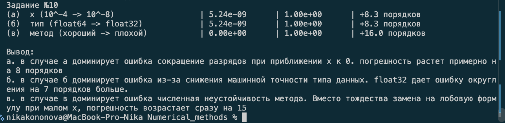
**Вывод:** a. в случае а доминирует ошибка сокращение разрядов при приближении x к 0. погрешность растет примерно на 8 порядков\nб. в случае б доминирует ошибка из-за снижения машинной точности типа данных. float32 дает ошибку округления на 7 порядков больше.\nв. в случае в доминирует ошибка численная неустойчивость метода. Вместо тождества замена на лобовую формулу при малом x, погрешность возрастает сразу на 15


### Задача 11
```python
x = 1e-8
def bad1(val):
    return (1 - math.cos(val))/(val**2)


def bad2(val):
    return (1.0 - math.cos(val) + 0.0)/(val**2)


def exact_11(val):
    mpmath.mp.dps = 50
    x_mp = mpmath.mpf(str(val))
    return (1 - mpmath.cos(x_mp)) / (x_mp**2)

res1 = bad1(x)
res2 = bad2(x)
exact_val = float(exact_11(x))

print(f"Результат алгоритма 1: {res1}")
print(f"Результат алгоритма 2: {res2}")
print(f"Эталон: {exact_val }\n")
print(f"Алгоритм 1 == Алгоритм 2: {res1 == res2}")
error_1 = abs(res1 - exact_val) / exact_val
error_2 = abs(res2 - exact_val) / exact_val

print(f"Относительная ошибка Алгоритма 1: {error_1:.2%}")
print(f"Относительная ошибка Алгоритма 2: {error_2:.2%}")
```
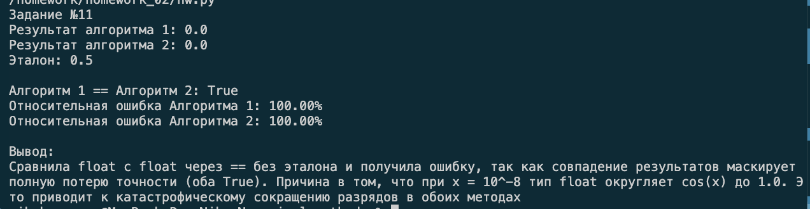
**Вывод:** Сравнила float с float через == без эталона и получила ошибку, так как совпадение результатов маскирует полную потерю точности (оба True). Причина в том, что при х = 10^-8 тип float округляет cos(x) до 1.0. Это приводит к катастрофическому сокращению разрядов в обоих методах

### Задача 12
```python
def bad_method(val):
    return math.sqrt(val + 1.0) - math.sqrt(val)

def exact_method(val):
    return 1.0 / (math.sqrt(val + 1.0) + math.sqrt(val))

num = [10**i for i in range(2, 17, 2)]
errors = []
for x in num:
    res_bad = bad_method(x)
    res_exact = exact_method(x)
    err = abs(res_bad - res_exact) / abs(res_exact)
    errors.append(err)
    print(f"{x:>10.0e} | {res_bad:>14.7e} | {res_exact:>14.7e} | {err:>10.2e}")

differential_x = math.log10(num[5]) - math.log10(num[1])
differential_y = math.log10(errors[5]) - math.log10(errors[1])
raz = differential_y / differential_x

print(f"\nЭкспериментальный наклон прямой в log-log: {raz:.2f}")
print(f"Теоретический наклон (степень x): 1.00")
```
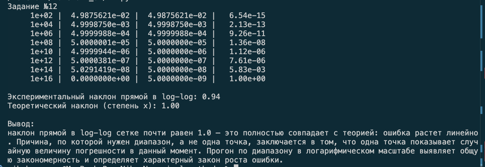
**Вывод:** наклон прямой в log-log сетке почти равен 1.0 — это полностью совпадает с теорией: ошибка растет линейно. Причина, по которой нужен диапазон, а не одна точка, заключается в том, что одна точка показывает случайную величину погрешности в данный момент. Прогон по диапазону в логарифмическом масштабе выявляет общую закономерность и определяет характерный закон роста ошибки

### Задача 13
```python
rint(f"Отчёт: Python {sys.version.split()[0]}, NumPy {np.__version__}, seed = 42 и 43\n")

random.seed(42)
arr1 = [random.uniform(0.1, 1.0) for _ in range(100000)]
rng1 = np.random.default_rng(42)
arr1_np = rng1.uniform(0.1, 1.0, size=100000)

sum_py1 = sum(arr1)
sum_math1 = math.fsum(arr1)
sum_np1 = float(np.sum(arr1_np))

sum_loop1 = 0.0
for val in arr1:
    sum_loop1 += val

print("Результаты для seed=42 (Запуск 1):")
print(f"  sum():    {sum_py1:.20f}\n  fsum():   {sum_math1:.20f}\n  цикл for: {sum_loop1:.20f}\n  np.sum(): {sum_np1:.20f}\n")

random.seed(42)
arr2 = [random.uniform(0.1, 1.0) for _ in range(100000)]
rng2 = np.random.default_rng(42)
arr2_np = rng2.uniform(0.1, 1.0, size=100000)

sum_py2 = sum(arr2)
sum_math2 = math.fsum(arr2)
sum_np2 = float(np.sum(arr2_np))

sum_loop2 = 0.0
for val in arr2:
    sum_loop2 += val

print("Результаты для seed=42 (Запуск 2):")
print(f"sum(): {sum_py2:.20f} | fsum(): {sum_math2:.20f} | цикл: {sum_loop2:.20f} | np.sum(): {sum_np2:.20f}")

random.seed(43)
arr3 = [random.uniform(0.1, 1.0) for _ in range(100000)]
rng3 = np.random.default_rng(43)
arr3_np = rng3.uniform(0.1, 1.0, size=100000)

sum_py3 = sum(arr3)
sum_math3 = math.fsum(arr3)
sum_np3 = float(np.sum(arr3_np))

sum_loop3 = 0.0
for val in arr3:
    sum_loop3 += val

print("Результаты для seed=43:")
print(f"sum(): {sum_py3:.20f} | fsum(): {sum_math3:.20f} | цикл: {sum_loop3:.20f} | np.sum(): {sum_np3:.20f}")

print(f"Расхождение при seed=42 (sum - fsum): {sum_py1 - sum_math1:.2e} | (np.sum - fsum(np)): {sum_np1 - math.fsum(arr1_np.tolist()):.2e}")
print(f"Расхождение при seed=43 (sum - fsum): {sum_py3 - sum_math3:.2e} | (np.sum - fsum(np)): {sum_np3 - math.fsum(arr3_np.tolist()):.2e}\n")

```
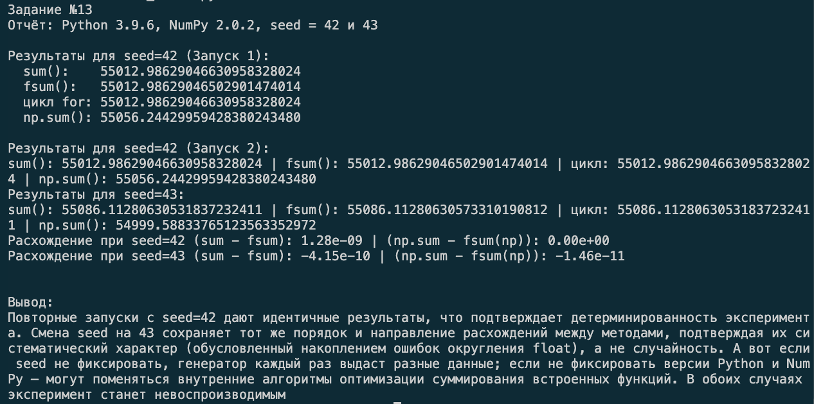
**Вывод:** овторные запуски с seed=42 дают идентичные результаты, что подтверждает детерминированность эксперимента. Смена seed на 43 сохраняет тот же порядок и направление расхождений между методами, подтверждая их систематический характер (обусловленный накоплением ошибок округления float), а не случайность. А вот если seed не фиксировать, генератор каждый раз выдаст разные данные; если не фиксировать версии Python — могут поменяться внутренние алгоритмы оптимизации суммирования встроенных функций. В обоих случаях эксперимент станет невоспроизводимым 


### Задача 14
```python
big = 1e300
small = 1e-300
zero = 0.0
denorm = 1e-320
inf = float('inf')
nan = float('nan')

test = {
    "1. Большие + Маленькие + 0": [big, small, zero, -big],
    "2. Денормализованные (denorm)": [denorm, denorm],
    "3. Наличие бесконечности (inf)": [big, inf, -big],
    "5. Наличие NaN (nan)": [1.0, nan, 2.0]
}

print(f"{'Тестовый набор':<38} | {'Наивная сумма':<15} | {'math.fsum()':<15}")
for title, arr in test.items():
    s_naive = 0.0
    for v in arr:
        s_naive += v
    s_fsum = math.fsum(arr)
    print(f"{title:<38} | {str(s_naive):<15} | {str(s_fsum):<15}")
```
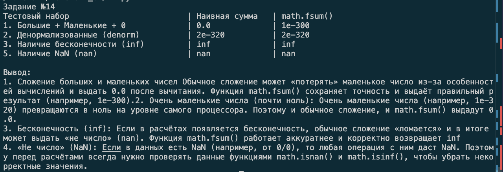
**Вывод:** 
1. Сложение больших и маленьких чисел Обычное сложение может «потерять» маленькое число из-за особенностей вычислений и выдать 0.0 после вычитания. Функция math.fsum() сохраняет точность и выдаёт правильный результат (например, 1e-300).
2. Очень маленькие числа (почти ноль): Очень маленькие числа (например, 1e-320) превращаются в ноль на уровне самого процессора.Поэтому и обычное сложение, и math.fsum() выдадут 0.0.\n3. Бесконечность (inf): Если в расчётах появляется бесконечность, обычное сложение «ломается» и в итоге может выдать «не число» (nan). Функция math.fsum() работает аккуратнее и корректно возвращает inf\n4. «Не число» (NaN): Если в данных есть NaN (например, от 0/0), то любая операция с ним даст NaN. Поэтому перед расчётами всегда нужно проверять данные функциями math.isnan() и math.isinf(), чтобы убрать некорректные значения.

### Задача 15
```python
getcontext().prec = 50
def bad_algorithm(val):
    return math.sqrt(val + 1.0) - math.sqrt(val)

def good_algorithm(val):
    return 1.0 / (math.sqrt(val + 1.0) + math.sqrt(val))

def exact_reference(val):
    dec_x = Decimal(str(val))
    return (dec_x + Decimal('1')).sqrt() - dec_x.sqrt()
num_range = [10**i for i in range(2, 17, 2)]
print(f"{'Вход x':<7} | {'Плохой':<12} | {'Хороший':<12} | {'Эталон':<12} | {'Ошибка плох.':<11} | {'Ошибка хор.'}")
for i in num_range:
    res_bad = bad_algorithm(i)
    res_good = good_algorithm(i)
    res_exact = exact_reference(i)

    error_bad = float(abs(Decimal(str(res_bad)) - res_exact) / abs(res_exact))
    error_good = float(abs(Decimal(str(res_good)) - res_exact) / abs(res_exact))

    print(f"{i:>7.0e} | {res_bad:<12.5e} | {res_good:<12.5e} | {float(res_exact):<12.5e} | {error_bad:<11.2e} | {error_good:.2e}")

```
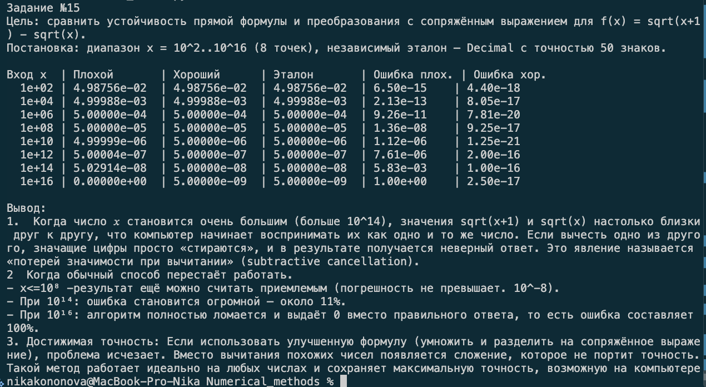
**Вывод:**
1. Когда число 𝑥 становится очень большим (больше 10^14), значения sqrt(x+1) и sqrt(x) настолько близки друг к другу, что компьютер начинает воспринимать их как одно и то же число. Если вычесть одно из другого, значащие цифры просто «стираются», и в результате получается неверный ответ. Это явление называется «потерей значимости при вычитании» (subtractive cancellation).
2. Когда обычный способ перестаёт работать.- х<=10⁸ -результат ещё можно считать приемлемым (погрешность не превышает. 10^-8). При 10¹⁴: ошибка становится огромной — около 11%. При 10¹⁶: алгоритм полностью ломается и выдаёт 0 вместо правильного ответа, то есть ошибка составляет 100%.
3. Достижимая точность: Если использовать улучшенную формулу (умножить и разделить на сопряжённое выражение), проблема исчезает. Вместо вычитания похожих чисел появляется сложение, которое не портит точность. Такой метод работает идеально на любых числах и сохраняет максимальную точность, возможную на компьютере
