# Блок 1. Обусловленность задачи (задачи 1–4)

### Задача 1
```python
mas = np.arange(60).reshape(3,4,5)
shape_mas = mas.shape
ndim_mas = mas.ndim
size_mas = mas.size
dtype_mas = mas.dtype
strides_mas =mas.strides
mas_C_CONTIGUOUS = mas.flags['C_CONTIGUOUS']
print(f"shape: {shape_mas}\nndim: {ndim_mas}\nsize: {size_mas}\ndtype: {dtype_mas}\nstrides: {strides_mas}\nC_CONTIGUOUS: {mas_C_CONTIGUOUS}")
```
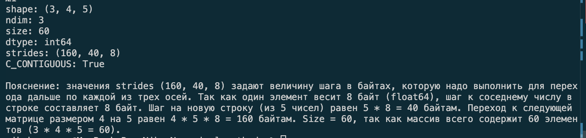
**Вывод:** значения strides (160, 40, 8) задают величину шага в байтах, которую надо выполнить для перехода дальше по каждой из трех осей. Так как один элемент весит 8 байт (float64), шаг к соседнему числу в строке составляет 8 байт. Шаг на новую строку (из 5 чисел) равен 5 * 8 = 40 байтам. Переход к следующей матрице размером 4 на 5 равен 4 * 5 * 8 = 160 байтам. Size = 60, так как массив всего содержит 60 элементов (3 * 4 * 5 = 60).

### Задача 2
```python
a = np.array([1, 2, 3, 4])
n_1 = a/2
n_2 = a//2
n_3 = a / 2.0
a_dtype = a.dtype
a_dtype_2 =(a / 2).dtype
a_dtype_3 = (a // 2).dtype

b = np.array([1, 2, 3], dtype=np.int8)
b_res = b + 127

print(f"a / 2: {n_1}\na // 2: {n_2}\na / 2.0: {n_3}\na.dtype: {a_dtype}\n(a / 2).dtype: {a_dtype_2}\n(a // 2).dtype: {a_dtype_3}\nb: {b}\nb + 127 = {b_res}\n(b + 127).dtype: {b_res.dtype}")
```
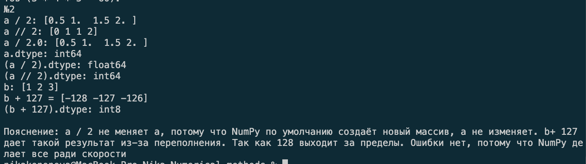
**Вывод:** a / 2 не меняет a, потому что NumPy по умолчанию создаёт новый массив, а не изменяет. b+ 127 дает такой результат из-за переполнения. Так как 128 выходит за пределы. Ошибки нет, потому что NumPy делает все ради скорости

### Задача 3
```python
error32 = float(np.float32(0.1)) - 0.1
error64 = float(np.float64(0.1)) - 0.1
print(f"float32 error:  {repr(error32)}\nfloat32 error: {error32:.20e}\nfloat64 error:  {repr(error64)}\nfloat64 error (.20e): {error64:.20e}\n")
ratio = abs(error32) / abs(error64) if error64 != 0 else float('inf')
print(f"Ошибка float32 больше ошибки float64 в {ratio} раз")
```
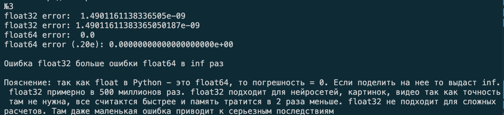
**Вывод:** так как float в Python - это float64, то погрешность = 0. Если поделить на нее то выдаст inf. float32 примерно в 500 миллионов раз. float32 подходит для нейросетей, картинок, видео так как точность там не нужна, все считактся быстрее и память тратится в 2 раза меньше. float32 не подходит для сложных расчетов. Там даже маленькая ошибка приводит к серьезным последствиям

### Задача 4
```python
num1 = np.zeros((2, 3), dtype=np.float64)
num2 = np.zeros((2, 3), dtype=np.float32)
num3 = np.ones((2, 3), dtype=np.int16)
num4 = np.full((2, 3), 7, dtype=np.uint8)
print(f"num1 (float64): dtype: {num1.dtype}, bytes: {num1.nbytes}\nnum2 (float32): dtype: {num2.dtype}, bytes: {num2.nbytes}\nnum3 (int16):   dtype: {num3.dtype}, bytes: {num3.nbytes}\nnum4 (uint8): dtype: {num4.dtype}, bytes: {num4.nbytes}\n")
element = 1000 * 1000
bytes_float64 = element * 8
bytes_float32 = element * 4
saved_bytes = bytes_float64 - bytes_float32
s = saved_bytes / (1024 * 1024)
print(f"В байтах: {saved_bytes} байт")
print(f"В мегабайтах: {s} МБ")
```
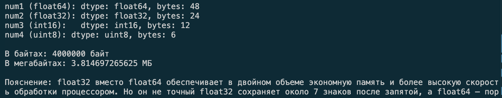
**Вывод:** float32 вместо float64 обеспечивает в двойном объеме экономную память и более высокую скорость обработки процессором. Но он не точный float32 сохраняет около 7 знаков после запятой, а float64 — порядка 16

---

# Блок 2. Устойчивость алгоритма (задачи 5–9)

### Задача 5
```python
a = np.arange(24)

num = [(4, 6), (2, 3, 4), (2, 2, 6), (24,)]

active = a
for sh in num:
    active = active.reshape(sh)
    equal = np.array_equal(a, active.ravel())
    print(f"Shape: {str(active.shape)} | Данные совпадают: {equal}")
```
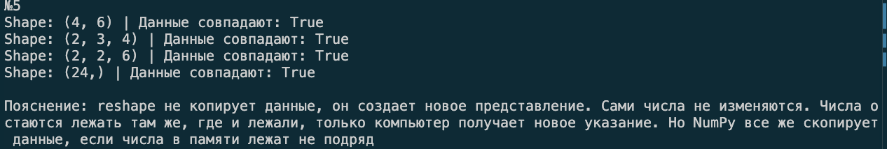
**Вывод:** reshape не копирует данные, он создает новое представление. Сами числа не изменяются. Числа остаются лежать там же, где и лежали, только компьютер получает новое указание. Но NumPy все же скопирует данные, если числа в памяти лежат не подряд

### Задача 6
```python
M = np.arange(12).reshape(3, 4)
flatten_M = M.flatten()
ravel_M= M.ravel()
print(f"f.base is None: {flatten_M.base is None}")
print(f"r.base is M: {ravel_M.base is M}\n")
flatten_M[0] = 999
ravel_M[1] = 888
print(f"M[0,0]: {M[0, 0]}")
print(f"M[0,1]: {M[0, 1]}")
```
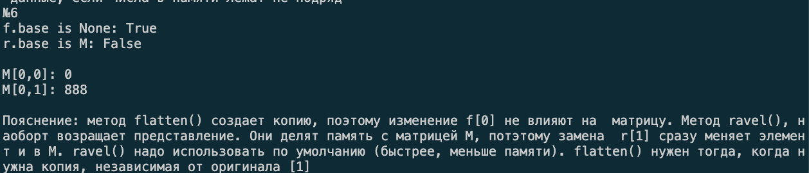
**Вывод:** метод flatten() создает копию, поэтому изменение f[0] не влияют на  матрицу. Метод ravel(), наоборт возращает представление. Они делят память с матрицей М, потэтому замена  r[1] сразу меняет элемент и в M. ravel() надо использовать по умолчанию (быстрее, меньше памяти). flatten() нужен тогда, когда нужна копия, независимая от оригинала [1]

### Задача 7
```python
v = np.arange(5)
print(f"v[:, None]: {v[:, None].shape}")
print(f"v[None, :]: {v[None, :].shape}")
print(f"squeeze: {np.squeeze(v[:, None]).shape}")
m_t = np.arange(6).reshape(2, 3).T
print(f"T shape: {m_t.shape}\n.T data:\n{m_t}")
res = v[:, None] + v[None, :]
print(f"Форма сложения: {res.shape}")
print(f"Матрица: {res}")
```
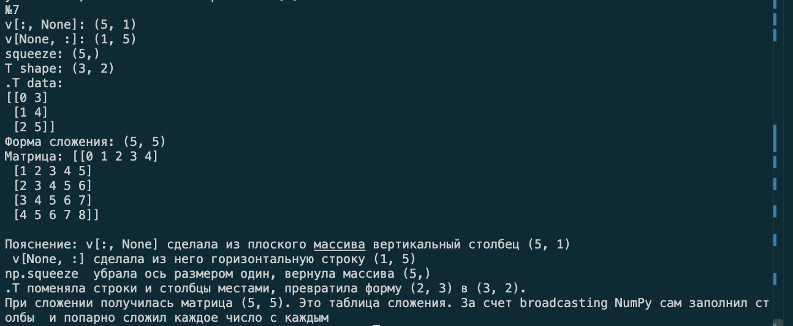
**Вывод:** v[:, None] сделала из плоского массива вертикальный столбец (5, 1)\n v[None, :] сделала из него горизонтальную строку (1, 5)\nnp.squeeze  убрала ось размером один, вернула массива (5,)\n.T поменяла строки и столбцы местами, превратила форму (2, 3) в (3, 2).\nПри сложении получилась матрица (5, 5). Это таблица сложения. За счет broadcasting NumPy сам заполнил столбы  и попарно сложил каждое число с каждым

### Задача 8
```python
A = np.arange(6).reshape(2, 3)
B = A.T
print(f"B.base is not None: {B.base is not None}")
B[0, 1] = 999
print(f"A = {A}")
```
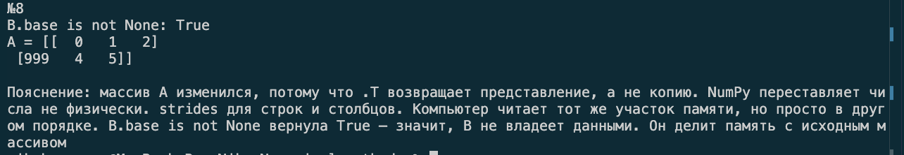
**Вывод:** массив A изменился, потому что .T возвращает представление, а не копию. NumPy переставляет числа не физически. strides для строк и столбцов. Компьютер читает тот же участок памяти, но просто в другом порядке. B.base is not None вернула True — значит, B не владеет данными. Он делит память с исходным массивом

### Задача 9
```python
A = np.arange(6).reshape(2, 3)
B = np.arange(6).reshape(3, 2)     
A_B = A @ B
A_B_T = A.T @ B.T
A_A = A * A                                                                                                              
print(f"A @ B = {A_B}, Shape = {A_B.shape}\nA.T @ B.T = {A_B_T}, Shape = {A_B_T.shape}\nA * A = {A_A}, Shape = {A_A.shape}")

```
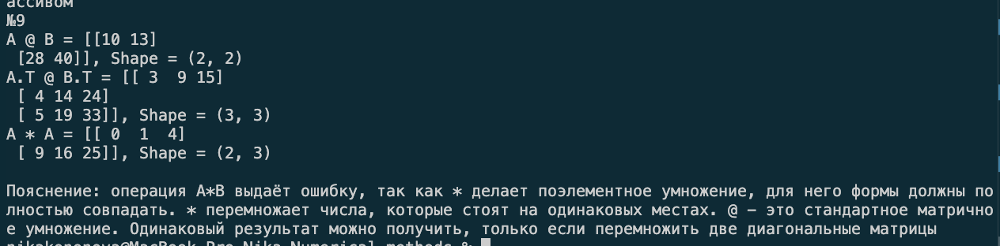
**Вывод:** операция А*B выдаёт ошибку, так как * делает поэлементное умножение, для него формы должны полностью совпадать. * перемножает числа, которые стоят на одинаковых местах. @ - это стандартное матричное умножение. Одинаковый результат можно получить, только если перемножить две диагональные матрицы

---

# Блок 3. Корректная постановка эксперимента (задачи 10–15)

### Задача 10
```python
M = np.arange(12).reshape(3, 4)
sum_axis0 = M.sum(axis=0)
sum_axis1 =M.sum(axis=1)
mean_axis0 = M.mean(axis=0)
mean_axis1 = M.mean(axis=1)
argmax_axis0 = M.argmax(axis=0)
argmax_axis1 = M.argmax(axis=1)

print(f"sum_axis0: {sum_axis0}\nsum_axis1: {sum_axis1}\nmean_axis0: {mean_axis0}\nmean_axis1: {mean_axis1}\nargmax_axis0: {argmax_axis0}\nargmax_axis1: {argmax_axis1}\nargmax_axis1: {argmax_axis1}\n")
mini_M = np.array([[1, 2], [3, 4]])
print(f"Маленький пример: {mini_M.sum(axis=0)}")
```
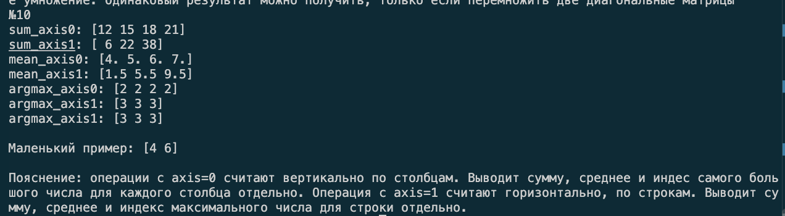
**Вывод:** операции с axis=0 считают вертикально по столбцам. Выводит сумму, среднее и индес самого большого числа для каждого столбца отдельно. Операция с axis=1 считают горизонтально, по строкам. Выводит сумму, среднее и индекс максимального числа для строки отдельно

### Задача 11
```python
X = np.random.default_rng(42).normal(size=(5, 3))
mean_X = X.mean(axis=0)
mean_X_kd = X.mean(axis=0, keepdims=True)
res_1 = X - mean_X
res_2 = X - mean_X_kd
X_norm = (X - X.mean(axis=1, keepdims=True)) / X.std(axis=1, keepdims=True)
print(f"X.mean(axis=0) shape: {mean_X.shape}\nX.mean(axis=0, keepdims=True) shape: {mean_X_kd.shape}Форма res_1: {res_1.shape}, Форма res_2: {res_2.shape}\nСредние по строкам: {X_norm.mean(axis=1)}\nStd по строкам (≈1): {X_norm.std(axis=1)}")
```
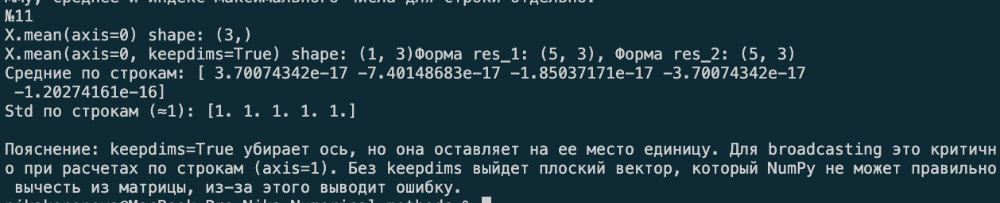
**Вывод:** keepdims=True убирает ось, но она оставляет на ее место единицу. Для broadcasting это критично при расчетах по строкам (axis=1). Без keepdims выйдет плоский вектор, который NumPy не может правильно вычесть из матрицы, из-за этого выводит ошибку

### Задача 12
```python
a = np.arange(10)
b = a[2:5]
b[0] = 999
print(f"После изменения b: a = {a}")
a = np.arange(10)
c = a[2:5].copy()
c[0] = 999
print(f"После изменения c: a = {a}")
```
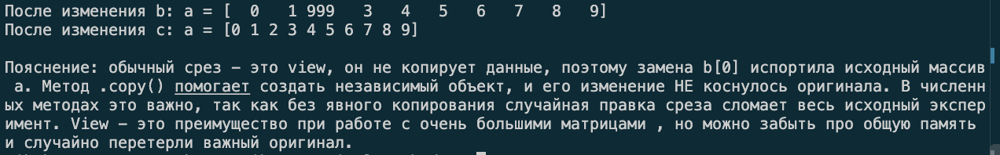
**Вывод:** обычный срез - это view, он не копирует данные, поэтому замена b[0] испортила исходный массив a. Метод .copy() помогает создать независимый объект, и его изменение НЕ коснулось оригинала. В численных методах это важно, так как без явного копирования случайная правка среза сломает весь исходный эксперимент. View - это преимущество при работе с очень большими матрицами , но можно забыть про общую память и случайно перетерли важный оригинал

### Задача 13
```python
a = np.random.default_rng(0).normal(size=20)
count_element = a[a > 0]
count = a[(a > -1) & (a < 1)]
fancy_idx = a[[0, 5, 10, 15]]
outliers = a[np.abs(a) > 2]
print(f"Количество элементов: {len(count_element)}\nКоличество элементов: {len(count)}\nВыборка по индексам: {fancy_idx}\nВыбросы: {outliers}")
a[a < 0] = 0
print(f"Массив после зануления отрицательных элементов:\n{a}")
```
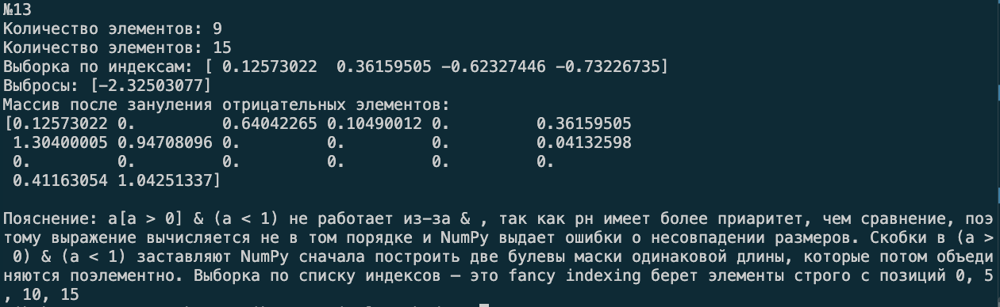
**Вывод:** a[a > 0] & (a < 1) не работает из-за & , так как рн имеет более приаритет, чем сравнение, поэтому выражение вычисляется не в том порядке и NumPy выдает ошибки о несовпадении размеров. Скобки в (a > 0) & (a < 1) заставляют NumPy сначала построить две булевы маски одинаковой длины, которые потом объединяются поэлементно. Выборка по списку индексов — это fancy indexing берет элементы строго с позиций 0, 5, 10, 15

### Задача 14
```python
X = np.random.default_rng(1).normal(size=(100, 3))
X_norm = (X - X.mean(axis=0)) / X.std(axis=0)
print(f"Средние по столбцам: {X_norm.mean(axis=0)}\nStd: {X_norm.std(axis=0)}")
D = np.sqrt(np.sum((X_norm[:, np.newaxis, :] - X_norm[np.newaxis, :, :]) ** 2, axis=-1))
print(f"Форма матрицы D: {D.shape}\nСреднее на диагонали: {np.mean(np.diag(D))}\nМатрица симметрична: {np.allclose(D, D.T)}")
```
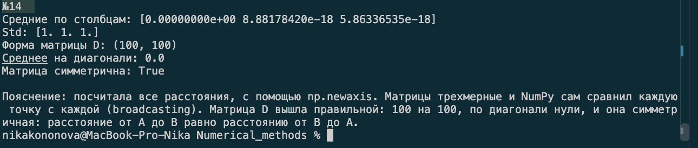
**Вывод:** посчитала все расстояния, с помощью np.newaxis. Матрицы трехмерные и NumPy сам сравнил каждую точку с каждой (broadcasting). Матрица D вышла правильной: 100 на 100, по диагонали нули, и она симметричная: расстояние от A до B равно расстоянию от B до A

### Задача 15
```python
rng = np.random.default_rng(42)
raw = rng.normal(20, 2, size=(30, 4))
raw[7, 2] = 100
raw_shape = raw.shape
raw_dtype = raw.dtype
raw_size = raw.size
print(f"Форма массива: {raw_shape}\nТип данных: {raw_dtype}\nРазмер массива: {raw_size}")

raw_mean = raw.mean(axis=0)
otklonenie = raw.std(axis=0)
raznica = np.abs(raw - raw_mean)
viborosi = raznica > 3 * otklonenie
skolko_viborosov = np.sum(viborosi)
print(f"Сколько всего выбросов нашли: {skolko_viborosov}")

raw_copy = raw.copy()
raw_copy[viborosi] = np.nan
srednee_nanmean = np.nanmean(raw_copy, axis=0)
raw_f = np.where(np.isnan(raw_copy), srednee_nanmean, raw_copy)
print(f"Значение в сломанной ячейке после замены: {raw_f[7, 2]}")

raw_T1 = raw_f.T
raw_T2 = raw_T1.T
proverka= np.array_equal(raw_f, raw_T2)
print(f"Массивы совпали после .T.T?: {proverka}")

raw_f_ravel = raw_f.ravel()
new_raw=raw_f_ravel.reshape(30, 4)
proverka2 = np.array_equal(raw_f, new_raw)
print(f"Форма после ravel: {raw_f_ravel.shape}\nМассивы совпали после reshape?: {proverka2}")

final_mean = raw_f.mean(axis=0)
final_std = raw_f.std(axis=0)
print(f"Среднее по датчикам: {final_mean}\nStd по датчикам: {final_std}")

norm_raw = (raw_f - final_mean) / final_std
print(f"Финальное среднее: {norm_raw.mean(axis=0)}\nФинальное std: { norm_raw.std(axis=0)}")
```
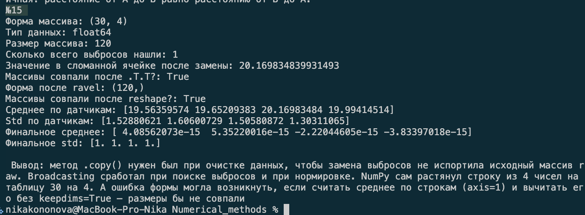
**Вывод:** метод .copy() нужен был при очистке данных, чтобы замена выбросов не испортила исходный массив raw. Broadcasting сработал при поиске выбросов и при нормировке. NumPy сам растянул строку из 4 чисел на таблицу 30 на 4. А ошибка формы могла возникнуть, если считать среднее по строкам (axis=1) и вычитать его без keepdims=True — размеры бы не совпали
