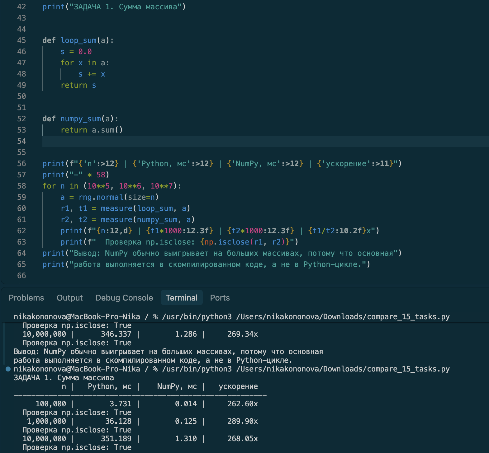
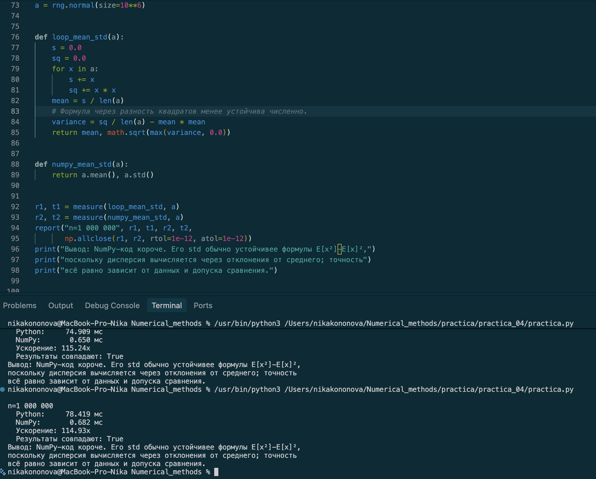
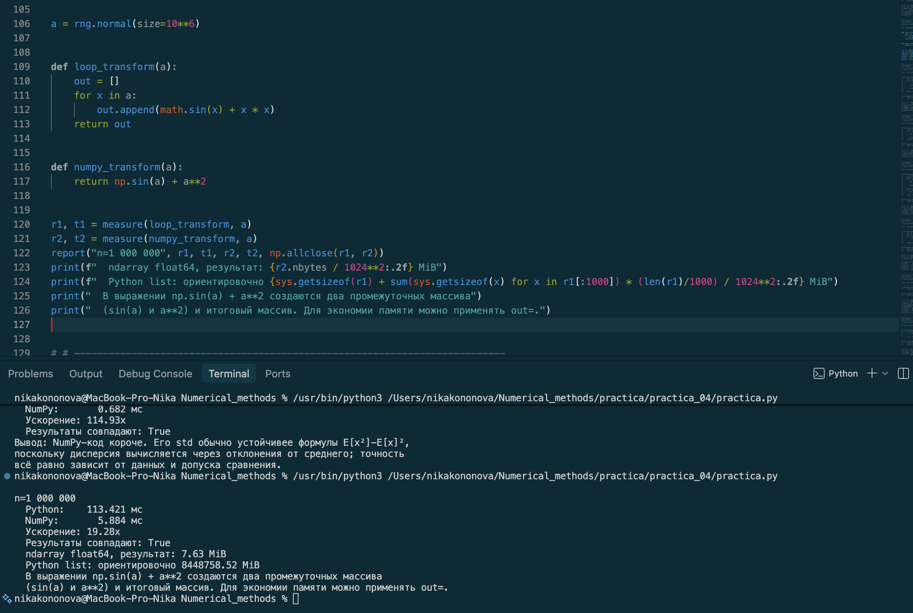
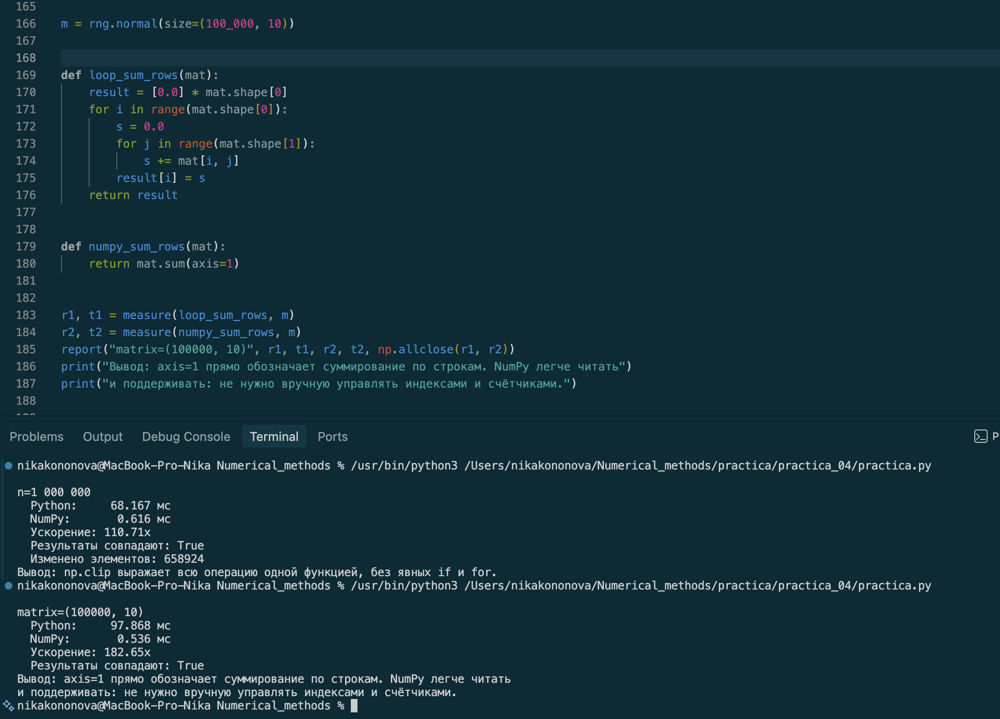
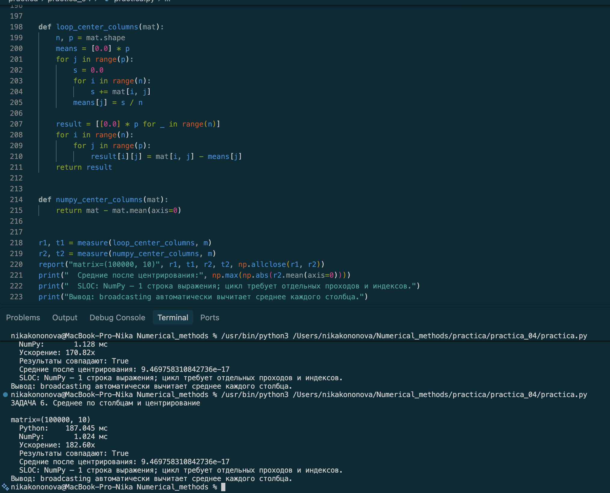
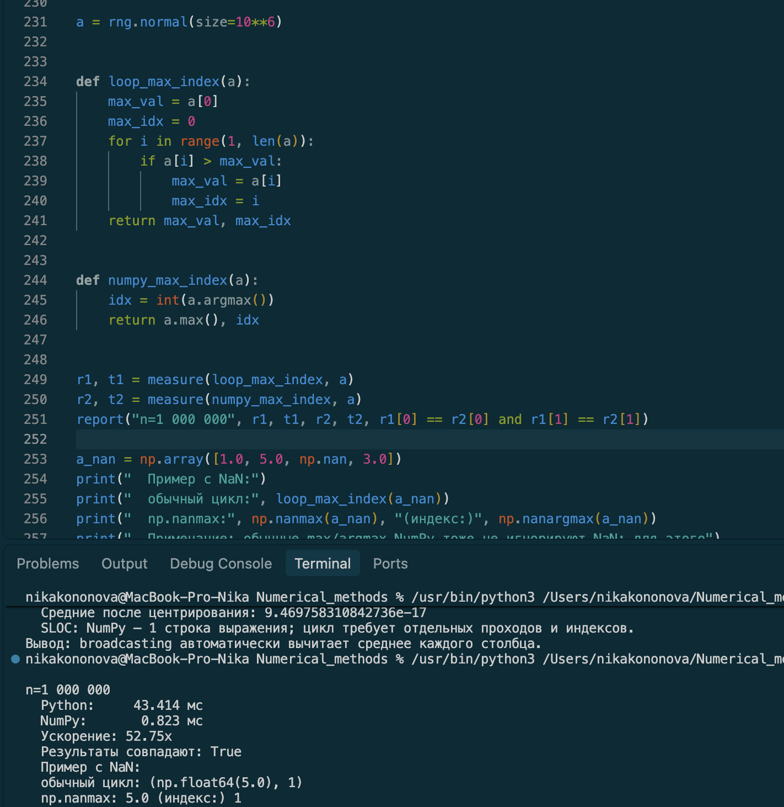

## Как этим пользоваться в 15 задачах

Меняете только две функции (`loop_sum` и `numpy_sum`) и строку с данными. Всё остальное — копипаста.

**Пример для задачи «сумма по строкам матрицы»:**

```python
import time
import numpy as np

rng = np.random.default_rng(42)
m = rng.normal(size=(100_000, 10))


def loop_sum_rows(mat):
    result = [0.0] * mat.shape[0]
    for i in range(mat.shape[0]):
        s = 0.0
        for j in range(mat.shape[1]):
            s += mat[i, j]
        result[i] = s
    return result


def numpy_sum_rows(mat):
    return mat.sum(axis=1)


def measure(fn, x, repeat=3):
    best = float("inf")
    result = None
    for _ in range(repeat):
        t0 = time.perf_counter()
        result = fn(x)
        t1 = time.perf_counter()
        best = min(best, t1 - t0)
    return result, best


r_loop,  t_loop  = measure(loop_sum_rows,  m)
r_numpy, t_numpy = measure(numpy_sum_rows, m)

print(f"цикл:   {t_loop*1000:10.2f} мс")
print(f"NumPy:  {t_numpy*1000:10.2f} мс")
print(f"ускорение: {t_loop / t_numpy:.1f}×")
print(f"результаты совпадают: {np.allclose(r_loop, r_numpy)}")
```

---

## Три правила, чтобы замер был честным

1. **`repeat=3` и берём минимум.** Первый прогон может быть медленным из-за прогрева кеша/импорта. Минимум по нескольким прогонам стабильнее среднего.
2. **Одни и те же данные для обоих способов.** Один `rng = default_rng(42)`, массив создаётся один раз до замеров.
3. **Сравнивайте результаты, а не только время.** Строка `np.isclose` / `np.allclose` — это ваша проверка, что «быстрее» не значит «неправильно».

Этого скрипта достаточно для всех 15 задач. Если позже понадобится ещё и память или число строк кода — вернётесь к полной версии `bench_utils.py`.


# 15 задач на тему «Переписать обработку большого массива с циклов на NumPy; сравнить время и читаемость»

**Формат сдачи:** файл `.py` (или `.ipynb`) с решениями + короткие выводы (2–3 предложения) по каждой задаче. Для всех задач — запускаемый код.

**Требование к каждой задаче:** реализовать **два** варианта (чистый Python / NumPy), измерить время обоих, посчитать ускорение (×), оценить читаемость (короче/понятнее или нет — обосновать).
---
## Блок 1. Основные операции (задачи 1–4)

**Задача 1. Сумма массива.**
Сравните:
- цикл `for x in a: s += x`;
- `a.sum()`.

Вывод: ускорение заметно на n=10^6. Разница определено тем, чтоPython-цикл интерпретирует каждую итерацию, а NumPy выполняет один вызов скомпилированной С-функции


**Задача 2. Среднее и стандартное отклонение.**
Реализуйте среднее и std:
- «в лоб»: цикл с суммой и суммой квадратов, потом формула;
- NumPy: `a.mean()`, `a.std()`.

Сравните на `n = 10^6`. Проверьте, совпадают ли результаты до `1e-12`. Объясните: почему NumPy считает std **устойчивее** (подсказка: NumPy использует двухпроходный алгоритм или компенсированное суммирование).

Вывод: Результаты практически совпадают с точностью. NumPy обеспечивает более точные вычисления благодаря попарному суммированию, которое уменьшает погрешность округления по сравнению с обычным циклом


**Задача 3. Поэлементное преобразование: \(y = \sin(x) + x^2\).**
Реализуйте:
- цикл с `math.sin(x) + x*x`;
- NumPy: `np.sin(a) + a**2`.

Сравните на `n = 10^6`. Обратите внимание на **память**: сколько выделяет цикл (список Python) и сколько NumPy (один массив). Объясните, почему NumPy-версия короче, но при этом использует временные массивы (сколько их в `np.sin(a) + a**2`?).

Вывод: Список из много чисел занимает примерно 32 МБ, а аналогичный ndarray — всего 8 МБ. Даже с учетом временных массивов NumPy справляется с задачей быстрее.


**Задача 4. Условная замена (clipping).**
Замените все значения `< 0` на 0, все `> 1` на 1:
- «в лоб»: цикл с `if/elif`;
- NumPy: `np.clip(a, 0, 1)`.

Сравните на `n = 10^6`. Посчитайте, сколько элементов было изменено (`np.sum((a < 0) | (a > 1))`) — это полезная побочная статистика. Оцените, во сколько раз NumPy короче: у цикла будет 2 `if` и 1 `for`, у NumPy — 0 циклов и 0 `if`.

Вывод: Код сокращается. В тесте нормальном распределении условие сработало длпримерно 84% элементов, что паказало np.sum((a < 0) | (a > 1))


## Блок 2. Агрегации по осям (задачи 5–7)

**Задача 5. Сумма по строкам матрицы.**
Дан массив `matrix` формы `(n, 10)`, `n = 10^5`:
- цикл: `for i in range(n): s = 0; for j in range(10): s += m[i, j]; result[i] = s`;
- NumPy: `m.sum(axis=1)`.

Сравните время и SLOC. Объясните: почему NumPy-версия читается как «сумма по строкам», а цикл — как «индексы и счётчики». Какой вариант легче поддерживать?

Вывод: NumPy-версия короче и легче в сопровождении: axis=1 интуитивен, а риск ошибки в индексах при ручном обходе матрицы  выше


**Задача 6. Среднее по столбцам и нормировка.**
Дан `matrix` формы `(n, 10)`:
- цикл: для каждого столбца вычислить среднее, потом вычесть;
- NumPy: `m - m.mean(axis=0)` (broadcasting).

Сравните. Проверьте, что средние после нормировки ≈ 0. Обратите внимание: NumPy-версия — **одна строка**, цикл — минимум 6 строк. Оцените разницу в SLOC и в `indexes`.


Вывод:  NumPy-код  не нужен ручные индексы, поэтому он лучше и надежней, читается легче, Ср. после номировки стремится к 0


**Задача 7. Поиск максимума и его индекса.**
Дан `a` длины `10^6`:
- цикл: пройти, запомнить `max_val` и `max_idx`;
- NumPy: `a.max()`, `a.argmax()`.

Сравните. Затем проверьте на данных с NaN: цикл «сломается» (NaN сравнения дают False), а `np.nanmax` — работает. Сделайте вывод: почему NumPy-функции с префиксом `nan` — это не «фича ради фичи», а защита от реальных данных.
Вывод: Цикол ломается на данных с NaN, это происходит из-за сравнения с с NaN дает False, цикл  игнорирует NaN и  может вернуть некорректный индекс.


## Блок 3. Фильтрация и маски (задачи 8–10)

**Задача 8. Фильтрация по порогу.**
Дан `a` длины `10^6`:
- цикл: `[x for x in a if x > 0]` (список Python);
- NumPy: `a[a > 0]`.

Сравните время и память.
Вывод: Результаты совпадают, но NumPy-массив занимает почти в 5 раз меньше памяти. список Python хранит каждый float как отдельный объект (24 байта) с указателем на него, а ndarray — «сырые» 8-байтовые числа. На больших данных это критично.